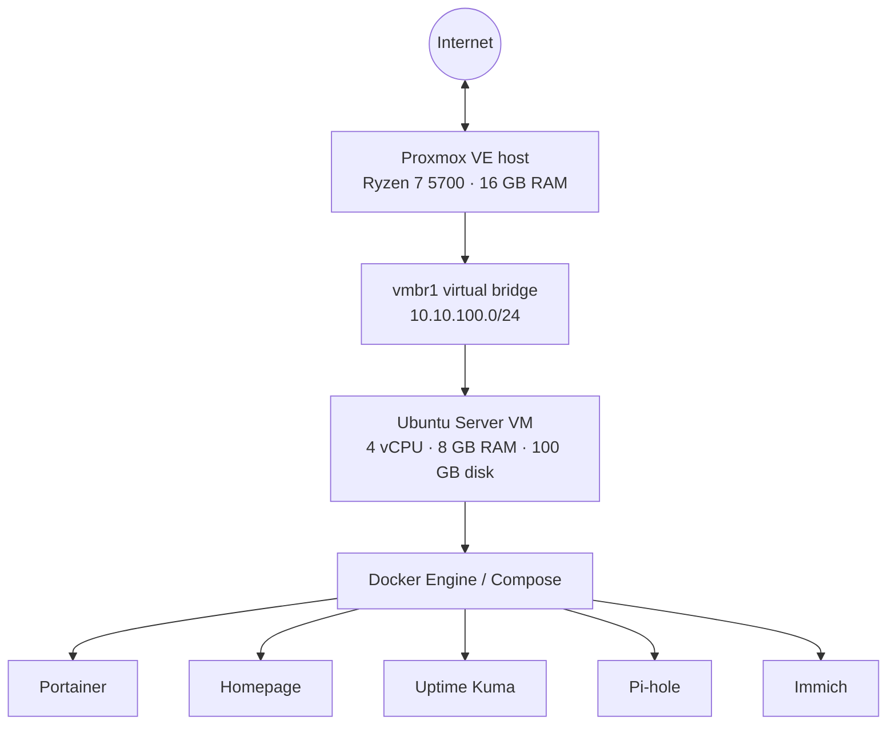

# Home Lab

My personal homelab project documenting virtualization, self-hosted services, networking, and system configurations.

## Hardware

| Component | Hardware |
|---|---|
| CPU | AMD Ryzen 7 5700 |
| Motherboard | Gigabyte B550 Gaming X V2 |
| RAM | 32 GB DDR4 |
| Hypervisor | Proxmox VE |

## Virtualization

Proxmox host: `vince-homelab`

| Setting | Value |
|---|---|
| VM ID | 100 |
| VM name | homelab |
| Guest OS | Ubuntu Server |
| vCPUs | 4 |
| Memory | 8 GB |
| Virtual disk | 100 GB |

## Networking

The Proxmox host uses a Linux bridge and NAT for the VM network.

| Component | Configuration |
|---|---|
| Bridge | vmbr1 |
| Bridge address | 10.10.100.1/24 |
| VM subnet | 10.10.100.0/24 |
| NAT interface | wlan0 |
| NAT | iptables masquerading |

## Self-hosted services

| Service | Purpose |
|---|---|
| Portainer | Docker management |
| Homepage | Homelab dashboard |
| Uptime Kuma | Service monitoring |
| Pi-hole | DNS filtering |
| Immich | Photo and video management |

## Repository structure

- `proxmox/` — VM, networking, and storage configurations.
- `services/` — Docker Compose configurations.
- `.env.example` — Environment variable template.
- `documentation/` — Guides and architecture notes.
- `scripts/` — Automation and maintenance scripts.

## Security

- Real `.env` files are excluded from Git.
- Passwords and API keys must not be committed.
- Private SSH keys and certificates must remain private.
- Backups, databases, and personal media are stored separately.

## Project status

This repository is being reconstructed from previous homelab configurations. Some configurations may need updating before redeployment.
# home-lab
## Architecture

The homelab is designed around a Proxmox host running an Ubuntu Server virtual
machine. Docker Compose runs the self-hosted applications inside that VM.

See [Architecture](docs/architecture.md) and
[Networking and storage](docs/networking-and-storage.md) for implementation
details.

## Engineering notes

This repository documents a homelab configuration and its design decisions.
The host and services are currently offline, so the files should be treated as
a reconstruction of the previous setup rather than proof of a currently
running deployment.

- [Challenges and lessons learned](docs/lessons-learned.md)
- [Networking and storage](docs/networking-and-storage.md)

## Current status

- [x] Preserve selected Proxmox host, VM, storage, and network configuration
- [x] Preserve Docker Compose definitions and safe example environment files
- [ ] Reinstall/redeploy the host and validate the configuration
- [ ] Verify each service and monitoring endpoint after redeployment
- [ ] Update this README with verified deployment results
