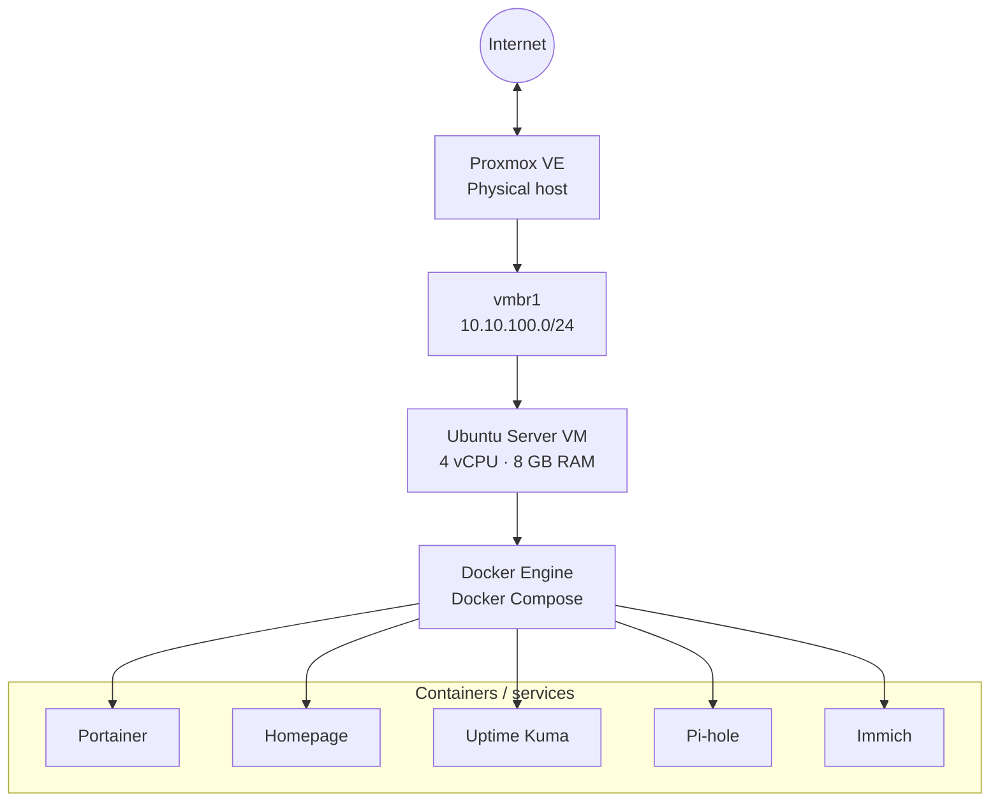

# Homelab architecture

## Overview

The previous deployment used a two-layer virtualization and application
architecture:

1. **Proxmox VE** provided the physical-host virtualization layer.
2. **Ubuntu Server** ran as a virtual machine on Proxmox.
3. **Docker Compose** managed the application services inside Ubuntu.

This kept application deployment separate from the hypervisor configuration.
It also made the application stack easier to recreate from Compose files.

## Hardware and virtual machine

| Component | Previous configuration |
|---|---|
| Motherboard | Gigabyte B550 Gaming X V2 |
| CPU | AMD Ryzen 7 5700 |
| Memory | 16 GB DDR4 |
| Hypervisor | Proxmox VE |
| VM name | `homelab` |
| Guest OS | Ubuntu Server |
| vCPU | 4 |
| Memory | 8 GB |
| Virtual disk | 100 GB |
| Virtual network | `vmbr1` |

These values describe the previous configuration and should be checked against
the host before redeployment.

## Application services

The Ubuntu VM previously hosted the following services through Docker Compose:

| Service | Role |
|---|---|
| Portainer | Web interface for managing Docker environments |
| Homepage | Homelab service dashboard |
| Uptime Kuma | Service availability monitoring |
| Pi-hole | Network-level DNS filtering |
| Immich | Self-hosted photo and video management |

The repository contains Compose definitions and example environment files.
Real `.env` files, passwords, databases, media libraries, and VM backups do
not belong in this public repository.

**Homepage note:** the repository contains both a Homepage definition in the
main Compose file and a separate Homepage Compose file. They represent
alternative deployment definitions; do not start both on the same host unless
you intentionally change their ports and networking.

## Architecture diagram

## Operational status

The homelab is currently offline. This documentation records the previous
design and configuration; it does not claim that the services are currently
deployed or reachable. After rebuilding, update this page with verified
versions, storage locations, service URLs, and test results.
